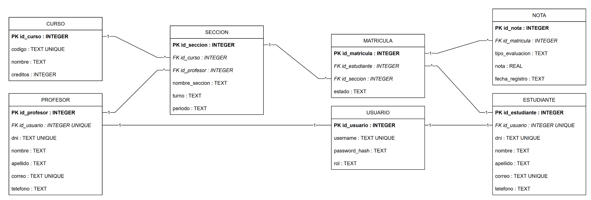
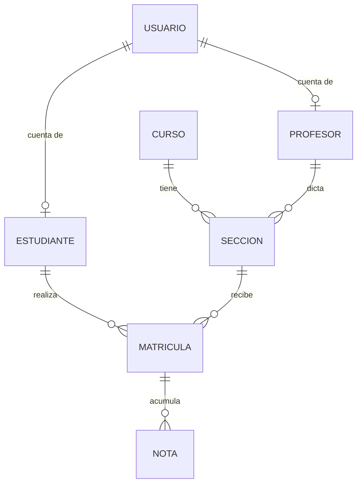

# Ejercicio 2 — Modelo entidad-relación (ER)

**Guía (Sesión 07 — Lenguajes de Programación):** «Diseñen un modelo entidad-relación (ER) que represente la estructura de la base de datos».

## Qué se hizo

Se diseñó el modelo ER del sistema de notas con **7 entidades**. El diagrama
final (draw.io, versión 3 del grupo) es `sistema_notas_er_v3.drawio`, exportado
como `sistema_notas_er_v3.png`:

| Entidad | Atributos | Relaciones |
|---|---|---|
| `USUARIO` | id_usuario (PK), username (UNIQUE), password_hash, rol | 1:1 con `ESTUDIANTE`, 1:1 con `PROFESOR` |
| `ESTUDIANTE` | id_estudiante (PK), id_usuario (FK UNIQUE), dni (UNIQUE), nombre, apellido, correo (UNIQUE), telefono | 1:1 con `USUARIO`, 1:N con `MATRICULA` |
| `PROFESOR` | id_profesor (PK), id_usuario (FK UNIQUE), dni (UNIQUE), nombre, apellido, correo (UNIQUE), telefono | 1:1 con `USUARIO`, 1:N con `SECCION` |
| `CURSO` | id_curso (PK), codigo (UNIQUE), nombre, creditos | 1:N con `SECCION` |
| `SECCION` | id_seccion (PK), id_curso (FK), id_profesor (FK), nombre_seccion, turno, periodo | 1:N con `MATRICULA` |
| `MATRICULA` | id_matricula (PK), id_estudiante (FK), id_seccion (FK), estado | 1:N con `NOTA`; resuelve el N:M estudiante-curso |
| `NOTA` | id_nota (PK), id_matricula (FK), tipo_evaluacion, nota (REAL), fecha_registro | N con `MATRICULA` |

## Decisiones de diseño

1. **Cuentas separadas de personas**: `USUARIO` guarda el login
   (`username`, `password_hash`, `rol`) y `ESTUDIANTE`/`PROFESOR` guardan los
   datos personales. La relación 1:1 se garantiza con
   `id_usuario INTEGER UNIQUE` en cada tabla hija.
2. **N:M estudiante ↔ curso resuelto con `MATRICULA`**: el estudiante no se
   vincula directamente al curso sino a la `SECCION` del curso; así queda
   registrado además el turno, el periodo y el profesor que lo evalúa.
3. **Las notas cuelgan de la matrícula**, no del estudiante: la misma nota
   solo existe dentro de una matrícula concreta (ese curso, ese periodo).
4. **Restricciones de unicidad** en `codigo`, `dni`, `correo` y `username` para
   evitar duplicados de identidad.
5. **Tipos acordes al uso**: `INTEGER` para claves y créditos, `TEXT` para
   cadenas y fechas (SQLite no tiene tipo fecha), `REAL` para la nota
   (permite decimales, escala 0–20).
6. **`PRAGMA foreign_keys = ON`** en cada script: en SQLite las `FOREIGN KEY`
   solo se controlan si se activa ese pragma.

## Referencias consultadas

- SQLite. *CREATE TABLE / FOREIGN KEY / ALTER TABLE*. https://www.sqlite.org/lang.html
- Koha Community. *Koha Library System* (modelo de catálogo y préstamos como
  referencia de modelos académicos). https://koha-community.org
- Downey, A., Elkner, J. & Meyers, C. (2002). *Aprenda a Pensar como un
  Programador con Python*. (Bibliografía de la guía de la sesión 07).
- Duque, R. G. (2011). *Python para todos*. (Bibliografía de la guía de la
  sesión 07).

